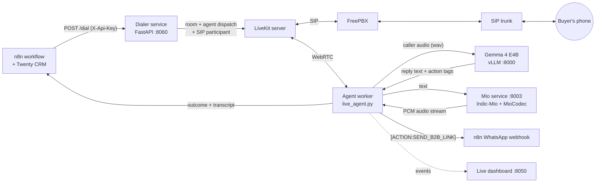

# Aegis Voice Agent

**A fully self-hosted outbound voice agent that calls B2B leads in Hindi, English and Hinglish, sends the catalogue on WhatsApp, and writes the transcript and outcome back to your CRM.**


[](https://colab.research.google.com/github/YOUR_GITHUB_USER/aegis-voice-agent/blob/main/notebooks/colab_launcher.ipynb)

<!-- Add a 60-90 s demo GIF/video here: a real call with the live dashboard beside it. -->
<!--  -->

Built for [M.A. Creations](https://b2b.macreations.in), a wooden-handicrafts manufacturer in Noida, to replace manual cold-calling of wholesale buyers. n8n triggers a call, the agent talks to the buyer, and when the call ends the outcome lands in Twenty CRM.

## Why it is interesting

- **One multimodal model does the listening and the thinking.** Gemma 4 E4B receives the caller's raw audio and replies in text. There is no separate speech-to-text model, which removes a stage of latency and a source of Hinglish transcription errors.
- **Natural Indian-language voice.** [Indic-Mio](https://huggingface.co/SPRINGLab/Indic-Mio) speaks the reply in a cloned reference voice, clause by clause, so audio starts before the full sentence is generated. A phonetic layer turns English loanwords, numbers and the portal URL into speakable Devanagari.
- **Runs on a single 24 GB L4 GPU.** Gemma and Indic-Mio run on vLLM side by side (about 30% and 15% of GPU memory).
- **Telephony without a cloud dialer.** LiveKit SIP dials through your own FreePBX and SIP trunk. A small TCP bridge plus an `LD_PRELOAD` shim lets the agent reach a private LiveKit server from Colab, which has no TUN device.
- **Conversation handling that feels like a call.** Barge-in with a minimum duration, backchannel filtering ("hmm" does not interrupt her), silence gating, clean hang-up after a goodbye, and warm transfer to a human extension.
- **Built to be driven by automation.** The dial API is idempotent by `job_id`, enforces a calling window and a concurrency cap, restricts callback hosts, and keeps an on-disk outbox for outcomes n8n could not receive.

## Architecture



| Component | File | Role |
|---|---|---|
| Agent worker | `src/live_agent.py` | LiveKit agent: audio in, Gemma reply, Mio voice out, call lifecycle, outcome callback |
| Dialer API | `src/dialer_service.py` | `POST /dial`: validation, window, concurrency, idempotency, SIP dial |
| Voice service | `src/mio_server.py` | Text to speech with Indic-Mio, number and loanword normalisation, clause streaming |
| Dashboard | `src/dashboard_backend.py` | Live call cockpit with transcript stream and lead counters |
| Prompt | `src/prompts/sys_prompt.txt` | Persona, language rules, company facts, action tags |
| Network bridge | `infra/tailscale_bridge/` | Reaches a private LiveKit host from Colab over Tailscale |
| Launcher | `notebooks/colab_launcher.ipynb` | Installs, starts and tests everything on a Colab L4 |

## Quick start (Colab L4)

1. Open `notebooks/colab_launcher.ipynb` in Colab and set the runtime to **L4 GPU**.
2. Add the secrets listed in [`.env.example`](.env.example) under the key icon (required: `TAILSCALE_AUTH_KEY`, `LIVEKIT_HOST`, `LIVEKIT_API_KEY`, `LIVEKIT_API_SECRET`, `TATA_PILOT_CLI`; recommended: `DIALER_API_KEY`, `N8N_WEBHOOK_SECRET`).
3. Optionally upload a 5-15 s reference voice as `/content/naina.wav`.
4. Run the cells top to bottom. The first run takes several minutes while the environments build.

You need your own LiveKit server with a SIP outbound trunk, and a SIP provider. Edit `src/prompts/sys_prompt.txt` and the greeting in `live_agent.py` for your company.

## API contract (n8n)

**Dial** `POST http://<host>:8060/dial`, header `X-Api-Key`:

```json
{"phone": "9XXXXXXXXX", "customer_name": "Rahul", "twenty_person_id": "<crm id>",
 "job_id": "{{ $execution.id }}", "callback_url": "{{ $execution.resumeUrl }}"}
```

Returns `202` with `{"status": "dialing", "job_id": "...", "room": "...", "call_id": "..."}`.
Errors: `401` bad key, `422` bad phone or callback host, `403` outside the calling window, `429` all call slots busy, `502` LiveKit/SIP failure. The same `job_id` never dials twice.

**Outcome** is POSTed once per call (answered or not) to `callback_url`, falling back to the CRM webhook:

```json
{"job_id": "...", "twenty_person_id": "...", "phone": "+919XXXXXXXXX", "customer_name": "Rahul",
 "room_name": "outbound-ab12cd34", "status": "completed | not_answered",
 "outcome": "completed | link_sent | transferred | no_answer | not_answered | no_participant",
 "duration": 74.2, "transcript": "assistant: ...\nuser: ...",
 "b2b_link_sent": true, "transferred_to_human": false, "sip_status": "hangup", "ended_at": 1760250000.0}
```

If n8n is unreachable after retries, the payload is saved to the outbox folder for replay.

## Performance

Measured on one Colab L4 with the default configuration. Fill these in from your own run (Cell 8 prints the `[llm]` and `[mio]` lines):

| Stage | Typical |
|---|---|
| Gemma first token | _measure_ |
| Mio first audio chunk | _measure_ |
| Caller stops speaking to first audio | _measure_ |

## Tests

```bash
pip install -r requirements.txt pytest
pytest
```

The tests cover the pure helpers: phone normalisation, Hindi number words, clause splitting, TTS text preparation and backchannel detection.

## Limitations and roadmap

- Gemma 4 E4B is small. Long, off-script conversations can drift, so replies are capped to short sentences and the prompt carries all company facts.
- Colab sessions are ephemeral. For production, run the same services on a dedicated GPU host (the bridge is then unnecessary).
- One reference voice, no live voice switching.
- Roadmap: per-call analytics, exported n8n workflow, CRM-driven prompt variables, automatic outbox replay.

## Responsible use

This system places real outbound sales calls. You are responsible for compliance with local telemarketing rules (in India: TRAI DND registry and commercial-communication regulations), calling only during permitted hours, honouring opt-outs, and disclosing that the caller is an AI where required. The calling-window guard in `/dial` is a safety net, not a legal guarantee.

Model licences apply separately: [Gemma terms of use](https://ai.google.dev/gemma/terms) and the Indic-Mio / MioCodec model cards.

## Credits

[LiveKit Agents](https://github.com/livekit/agents), [vLLM](https://github.com/vllm-project/vllm), [Gemma](https://ai.google.dev/gemma), [Indic-Mio](https://huggingface.co/SPRINGLab/Indic-Mio), [MioCodec](https://github.com/Aratako/MioCodec), [Tailscale](https://tailscale.com), [n8n](https://n8n.io), [Twenty CRM](https://twenty.com).

## License

MIT, see [LICENSE](LICENSE).
